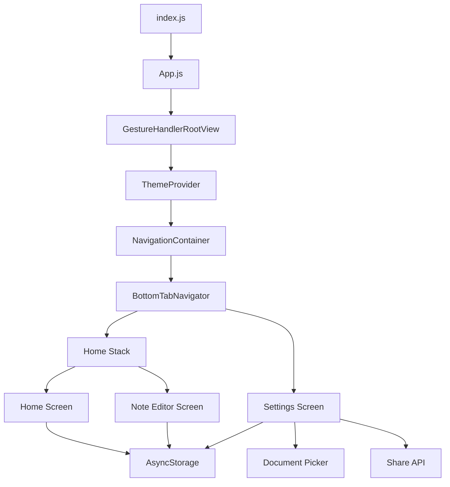

# NoteFlow

NoteFlow is a local first notes application built with Expo and React Native. It provides a simple place to capture ideas, reminders, and personal notes without requiring an account, backend service, or cloud synchronization.

The app stores data on the device, supports light and dark themes, and includes note organization, search, sorting, export, import, and draft recovery features.

## Features

### Notes

- Create, edit, and delete plain-text notes
- Add a title and multiline body
- Automatically save drafts for new notes
- View word count and relative timestamps
- Pin important notes so they appear first
- Mark notes as favorites
- Assign one of five note colors
- Undo the most recent note deletion
- Share a note through the device sharing sheet

### Home screen

- Displays the total number of notes
- Searches note titles
- Sorts by recently edited, newest created, or title A-Z
- Keeps pinned notes at the top of the list
- Provides swipe actions for favorite, pin, and delete
- Shows a dedicated empty state for an empty list or a search with no results

### Settings

- Choose System, Light, or Dark appearance
- Persist the selected theme on the device
- Export all notes as text
- Export all notes as JSON
- Import notes from a JSON file
- Clear all notes with a confirmation dialog
- View app and developer information

## Technology stack

- [Expo SDK 57](https://docs.expo.dev/versions/v57.0.0/)
- React Native 0.86.3
- React 19.2.3
- React Navigation 7
- React Native Gesture Handler
- AsyncStorage for local persistence
- Expo Document Picker for JSON imports
- Expo Vector Icons
- React Native Web support for the web target

## System architecture



### Main modules

| Path | Responsibility |
| --- | --- |
| `index.js` | Registers the Expo root component |
| `App.js` | Installs gesture handling, theme, and navigation providers |
| `navigation/BottomTabNavigator.js` | Defines the Home and Settings tabs |
| `navigation/HomeStack.js` | Defines the Notes list and Editor screens |
| `screens/HomeScreen.jsx` | Lists, searches, sorts, deletes, and restores notes |
| `screens/NoteEditorScreen.jsx` | Creates and edits notes, saves drafts, shares, and deletes |
| `screens/SettingsScreen.jsx` | Manages appearance, import, export, and clearing data |
| `components/` | Reusable list items, controls, dialogs, and empty states |
| `utils/storage.js` | Serializes note reads and writes to AsyncStorage |
| `utils/draftStorage.js` | Stores an unfinished new-note draft |
| `utils/undoStorage.js` | Stores the last deleted note for Undo |
| `utils/ThemeContext.js` | Resolves and persists the selected theme |
| `utils/ExportNotes.js` | Converts notes to text or JSON and shares them |
| `utils/ImportNotes.js` | Reads and validates a selected JSON file |
| `utils/noteSorting.js` | Sorts pinned notes and selected date/title fields |
| `utils/noteFilters.js` | Filters notes by title |
| `utils/noteColors.js` | Defines and validates note colors |
| `utils/timeUtils.js` | Formats relative timestamps and time zones |

## Data model

A note is stored as a JavaScript object with the following fields:

| Field | Type | Description |
| --- | --- | --- |
| `id` | string | Unique note identifier |
| `title` | string | Note title; an empty title is displayed as “Untitled note” |
| `body` | string | Multiline note content |
| `color` | string | One of the configured color values |
| `pinned` | boolean | Whether the note is pinned |
| `favorite` | boolean | Whether the note is favorited |
| `createdAt` | string | ISO date when the note was created |
| `editedAt` | string | ISO date when the note was last edited |

### Local storage keys

NoteFlow uses AsyncStorage and currently uses these keys:

| Key | Purpose |
| --- | --- |
| `notes` | The complete note collection |
| `noteDraft` | The current unfinished new-note draft |
| `lastDeletedNote` | The note available to the Undo action |
| `themePreference` | The selected System, Light, or Dark theme |

All note data is local to the device. Deleting the app, clearing app data, or clearing all notes can remove the stored data. Use JSON export as a backup when needed.

## Repository layout

```text
NoteFlow/
├── App.js
├── index.js
├── app.json
├── eas.json
├── package.json
├── package-lock.json
├── assets/
├── components/
├── navigation/
├── screens/
└── utils/
```

`node_modules/`, `.expo/`, `dist/`, native build folders, and local environment files are excluded by `.gitignore`.

## Prerequisites

Install the following before setting up the project:

- Git
- Node.js 22.13.x or newer
- npm, which is included with Node.js
- Expo Go on an Android or iOS device for quick testing
- Android Studio and an Android emulator/device for Android development
- macOS with Xcode for iOS development
- An Expo account and EAS CLI for managed cloud builds

Expo SDK 57 targets React Native 0.86 and requires Node.js 22.13.x or a compatible newer Node.js release.

## Clone the repository

Clone the project from GitHub:

```bash
git clone https://github.com/Klose-dev/NoteFlow.git
```

Enter the project directory:

```bash
cd NoteFlow
```

If the repository has already been cloned, update it with:

```bash
git pull
```

## Install dependencies

The repository includes `package-lock.json`. For a clean installation that matches the lockfile exactly, run:

```bash
npm ci
```

Use this command instead when you are intentionally changing dependencies:

```bash
npm install
```

When adding an Expo package, use the Expo-compatible installer so dependency versions stay aligned with SDK 57:

```bash
npx expo install package-name
```

## Start the app

Start the Expo development server:

```bash
npm start
```

This runs:

```bash
npx expo start
```

Expo displays a QR code and terminal options. You can:

- Press `a` to open an Android emulator or connected Android device
- Press `i` to open an iOS simulator on macOS
- Press `w` to open the web version
- Scan the QR code with the Expo Go app on a physical device

To clear the Metro cache when the app behaves unexpectedly:

```bash
npx expo start --clear
```

## Run a specific platform

The scripts in `package.json` provide these commands:

```bash
npm run android
npm run ios
npm run web
```

Platform notes:

- Android requires a configured emulator or connected device.
- iOS requires macOS and Xcode.
- The web target uses the installed React DOM and React Native Web dependencies.
- The first native launch may take longer while dependencies are prepared.

## Configure the app

### App identity and platform settings

Open [`app.json`](app.json). The `expo` object controls the app name, slug, version, orientation, theme default, platform identifiers, and EAS project connection.

Important fields include:

| Field | Current value or purpose |
| --- | --- |
| `expo.name` | `NoteFlow`, the display name |
| `expo.slug` | `noteflow`, the Expo project slug |
| `expo.version` | `1.0.0`, the app version |
| `expo.orientation` | `portrait` |
| `expo.userInterfaceStyle` | Native interface default; the in-app Settings screen also supports System, Light, and Dark |
| `expo.ios.bundleIdentifier` | `com.akongsehklose222.noteflow` |
| `expo.android.package` | `com.akongsehklose222.noteflow` |
| `expo.extra.eas.projectId` | Connects the project to its EAS Build project |

The iOS bundle identifier and Android package name must be unique for store distribution. If you publish the app under a different account or brand, replace both values consistently and use a valid reverse-DNS format such as `com.yourname.noteflow`.

To make the native interface follow the operating system by default, set:

```json
"userInterfaceStyle": "automatic"
```

Use `"light"` or `"dark"` when the app should have a fixed native default. The Settings screen still lets users choose their preferred appearance at runtime.

### App icons and splash assets

The project contains an `assets/` directory for app artwork. If you restore or add icon and splash files, reference them from `app.json` and verify that every configured path exists before building. For example, an icon configuration uses a path relative to the project root:

```json
"icon": "./assets/icon.png"
```

Android adaptive icons and splash configuration can also be defined under the platform-specific sections of `app.json`. Do not commit private signing keys, provisioning profiles, or credentials.

### Package scripts

The scripts in [`package.json`](package.json) are:

| Command | Action |
| --- | --- |
| `npm start` | Start Expo development server |
| `npm run android` | Start Expo for Android |
| `npm run ios` | Start Expo for iOS |
| `npm run web` | Start Expo for web |

The project currently has no dedicated lint or typecheck scripts. Use `npx expo-doctor` and manual testing on each supported platform during development.

### EAS Build profiles

Open [`eas.json`](eas.json) to configure managed builds:

- `development`: Creates a development client for internal testing.
- `preview`: Creates an internal preview build.
- `production`: Creates a production build and automatically increments the build number.
- `submit.production`: Contains the production submission configuration.

Install and authenticate the EAS CLI:

```bash
npm install -g eas-cli
eas login
```

Create an Android production build:

```bash
eas build --platform android --profile production
```

Create an iOS production build:

```bash
eas build --platform ios --profile production
```

EAS may ask you to configure Apple or Google credentials, signing credentials, or build capabilities. Follow the prompts for the account that owns the app identifiers in `app.json`.

## Import and export format

### Export

The Settings screen offers two export options:

- **Export all notes** creates plain text with each title and body separated by blank lines.
- **Export as JSON** creates a formatted JSON array containing the complete note objects and metadata.

Both options use the device sharing sheet, so the destination depends on the operating system and installed apps.

### Import

JSON import expects the selected file to contain a top-level array. Each item should be an object. The import process:

1. Reads the selected file with Expo Document Picker.
2. Validates that the file contains a JSON array.
3. Normalizes missing or invalid note fields.
4. Skips imported notes whose IDs already exist.
5. Adds new notes to the local collection.

A valid imported file looks like this:

```json
[
  {
    "id": "example-note-1",
    "title": "My note",
    "body": "Note content",
    "color": "#4C6FFF",
    "pinned": false,
    "favorite": false,
    "createdAt": "2026-09-21T00:00:00.000Z",
    "editedAt": "2026-09-21T00:00:00.000Z"
  }
]
```

The importer generates missing IDs and dates when possible, but exporting a JSON backup from NoteFlow is the safest way to preserve all metadata.

## Development workflow

1. Install dependencies with `npm ci`.
2. Start the development server with `npm start`.
3. Make changes in the relevant screen, component, navigation, or utility file.
4. Run `npx expo-doctor` to check project configuration and dependency compatibility.
5. Test the Home screen, editor, settings, import/export, theme changes, and deletion Undo on a device or simulator.
6. Clear the Metro cache with `npx expo start --clear` if stale bundles cause unexpected behavior.
7. Create an EAS build before release.

The storage helper queues writes so concurrent note updates are applied in order. New-note drafts are saved after a short delay, while saved notes are written when the user selects Done or shares the note.

## Troubleshooting

### The development server will not start

Confirm the Node.js version:

```bash
node --version
```

Use Node.js 22.13.x or newer for Expo SDK 57, then reinstall dependencies:

```bash
rm -rf node_modules
npm ci
npx expo start --clear
```

On Windows PowerShell, remove `node_modules` with:

```powershell
Remove-Item -Recurse -Force node_modules
```

### Dependencies do not match Expo SDK 57

Run:

```bash
npx expo install --fix
```

Then restart the development server.

### The app shows stale screens or assets

Clear the Metro cache:

```bash
npx expo start --clear
```

If necessary, reinstall the Expo Go app or rebuild the development client.

### Android or iOS will not launch

- Confirm that a simulator, emulator, or physical device is available.
- Confirm that Android Studio or Xcode is installed and configured.
- Run the platform command from the project root.
- Check that the package or bundle identifier in `app.json` is valid and unique.

### JSON import fails

The selected file must be valid JSON with a top-level array. Export a backup from NoteFlow and import that file to ensure compatibility.

### Notes do not appear on another device

NoteFlow is local-first and has no cloud synchronization. Notes are stored in AsyncStorage on the current device. Export a JSON backup and import it on another installation when moving data.

## Repository

Source code: [github.com/Klose-dev/NoteFlow](https://github.com/Klose-dev/NoteFlow)

## License

This repository includes an MIT license file. See [`LICENSE`](LICENSE) for the license text.
